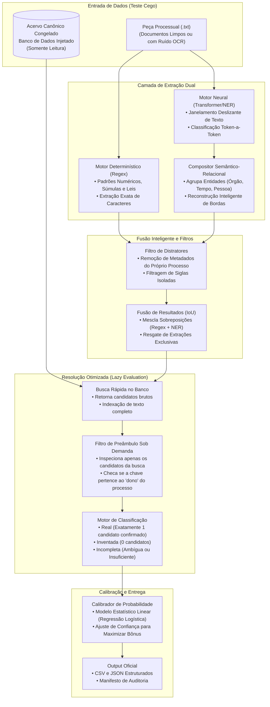

Vamos construi um pipeline para vencer o desafio que esta registrado no arquivo DESAFIO.MD. Seiga as regras  DESAFIO.MD verifique a melhor maneira de construir para facilitar que o pessoal do desafio rode nosso projeto sem demorar, tempo alto elimina.
Vamos publicar no hugging face caso tenhamos algum fine=tuning realzado.

Faremos dois testes em worktrees separadas. Uma fazemos finetuning do NER com nossa base disponivel  (nao podemos usar os dados canonicos dados pela competicao )

Voce é o arquiteto chefe otimize a arquitetura indicada abaixo

## Fase 1: Extração Híbrida (Encontrar os trechos)
Você deve implementar dois motores de extração paralelos que vasculham o texto em busca das citações:

 Motor Simbólico (Regex): Crie expressões regulares rígidas para capturar padrões estruturados que raramente variam, como números de processo no padrão CNJ, formatos padronizados de Súmulas e citações diretas a artigos de códigos legais.

 Motor Neural (NER): Treine e embarque um modelo de linguagem pequeno de pesos abertos (Transformer) focado em Reconhecimento de Entidades Nomeadas (NER). Ele será responsável por encontrar as citações escritas em linguagem natural solta ou que sofreram muito ruído de OCR. O modelo NER deve ser dominguesm/legal-bert-ner-base-cased-ptbr  mais detalhes em https://huggingface.co/dominguesm/legal-bert-ner-base-cased-ptbr  Respeite a licensa do modelo e cumpra com as obrigacoes no nosso repo

 Fusão (Fusion): Como os dois motores rodarão em paralelo, haverá sobreposições. Escreva um algoritmo de fusão (semelhante ao Non-Maximum Suppression) que calcula o Intersection over Union (IoU) dos trechos extraídos. Se o Regex e o NER encontrarem o mesmo trecho, unifique a extração garantindo que as bordas de início e fim sejam calculadas estritamente em codepoints Unicode.

## Fase 2: Normalização (Limpar o ruído)
Antes de buscar no banco de dados, o texto da citação extraída precisa ser sanitizado. Implemente funções de limpeza focadas no domínio jurídico e em ruído de digitalização. Crie regras para desfazer confusões clássicas de OCR (como trocar "S" por "5" na palavra Súmula, ou "l" por "1"). Extraia as partes numéricas das citações removendo pontos e traços de forma que "1.234.567" e "1234567" gerem a mesma string de busca unificada.

## Fase 3: Resolução (O cruzamento de dados)
Você deve conectar sua aplicação a um banco SQLite que serve como a "fonte da verdade". O desafio arquitetural aqui não é a busca textual (Full-Text Search), mas evitar Falsos Positivos contextuais. Processos citam outros processos o tempo todo. Se você apenas buscar um número no banco, ele retornará o processo correto E todos os outros processos que o citaram. Para resolver isso, crie um Índice de Cabeçalhos em memória. A regra fundamental do seu motor de busca deve ser: um registro do banco só é o "dono" daquela citação se o número do processo aparecer nas primeiras linhas (cabeçalho) do documento dele. Mapeie isso na inicialização do sistema para que as buscas sejam rápidas e precisas. Para leis e súmulas, a resolução é mais fácil: basta casar o texto normalizado contra a tabela específica de dispositivos.

## Fase 4: Classificação Baseada em Cardinalidade
Com o resultado da consulta ao banco, implemente a lógica de decisão que definirá o status da citação baseada no número de candidatos encontrados:

Se a busca retornar exatamente 1 candidato válido: Classifique como real. Atenção redobrada: recupere o id numérico primário do banco de dados (o identificador canônico) para atrelar ao resultado.
Se a busca não retornar candidatos (Count = 0): Isso significa que a IA geradora do texto inventou o número ou a citação. Classifique como inventada.
Se a busca retornar múltiplos candidatos sem critério de desempate OU se a citação não tiver dados suficientes para uma busca: Classifique como incompleta.
(Opcional mas recomendado) Implemente uma função analítica que atribua uma probabilidade de confiança de 0.0 a 1.0 para cada classificação, otimizando-a para reduzir o Brier Score.

## Fase 5: Formatação de Saída
Por fim, crie um construtor de saídas que valide os resultados. Para cada documento de texto processado, gere um payload contendo os offsets de início e fim, a classe inferida e o ID canônico. Em seguida, agregue o processamento de todos os documentos gerando um arquivo .csv final no formato tabular estrito exigido (ID do documento em uma coluna, e todas as citações concatenadas com pipes | na outra). Certifique-se de que não haja dependências de chamadas de rede; toda a arquitetura desenhada deve ser capaz de ser executada offline.

Os dados da pasta desafio-jusbrasil-bracis-2026 apenas podem ser usadas para teste cego para avaliar nosso pipeline.

Voce pode se inspirar nas regras de regex da solucao presente em C:\Users\lucas\OneDrive\Área de Trabalho\antigravity-juris use apenas a parte do regex dessa solucao nao se influencie por ela.

Segue um exemplo de arquitetura, voce tem que otimizar. 

RULES:
Separe o que é treinamento (fine-tunig e etc) e preparacao da solucao final, do codigo de execucao do pipeline, pois a banca apenas vai rodar nossa solucao nao retreinar e refazer step pre computados ou que exigem muita computacao.
So é permitido se inspirar na parte do regex de C:\Users\lucas\OneDrive\Área de Trabalho\antigravity-juris
Codigo simples e comentado em portugues
Menos codigo é melhor!
Pipeline deve ser facil de rodar com poucos comandos e sem  parametros opcionais
Sempre revise se esta seguindo as regras do DESAFIO.MD
Reprodutibilidade é obrigatorio portanto devemos ter um produto final reprodutivel ponta a ponta
Cuida das licenças e as obrigacoes delas.  Documente tudo em .md desde arquitetura, como foi feito, detalhes importantes da implementacao
modelos usados, suas licencas, a liceça nossa deve ser aberta seguindo as orientacoes das licencas que consumimos
Prepare e documente para publicarmos no hunging face 
Para base que usaremos deixe creditos a  Eduardo Osti e Thiago Meirelles Ventura por ter disponibilizado os dados brutos para base

