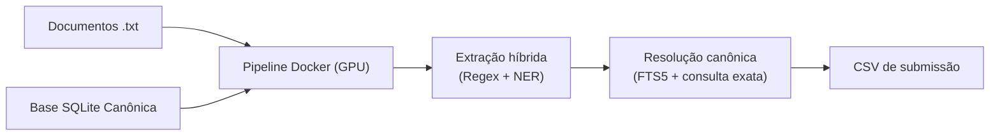

# Verificador de Citações Jurídicas — Desafio Jusbrasil x BRACIS 2026

Solução para resolver e classificar citações jurídicas em documentos judiciais como **reais**, **inventadas** ou **incompletas**.

## Pré-requisitos

- Docker Desktop ou Docker Engine configurado para contêineres Linux.
- GPU NVIDIA e drivers configurados para acesso pelo Docker. No Linux, instale o [NVIDIA Container Toolkit](https://docs.nvidia.com/datacenter/container-toolkit/latest/install-guide.html); no Windows, use o Docker Desktop com suporte NVIDIA via WSL 2.

- Bash no Linux/WSL ou PowerShell no Windows.

## Executar

Passe o caminho do banco SQLite, a pasta com os `.txt` e o caminho completo para o CSV. O caminho de saída pode ser escolhido livremente; caminhos relativos partem do diretório atual.

```bash
bash run.sh ./data/desafio-jusbrasil-bracis-2026/desafio1_bracis.db ./data/desafio-jusbrasil-bracis-2026/txt ./output/submission.csv
```

No Windows PowerShell:

```powershell
.\run.ps1 .\data\desafio-jusbrasil-bracis-2026\desafio1_bracis.db .\data\desafio-jusbrasil-bracis-2026\txt .\output\submission.csv
```

O script constrói a imagem a partir do Dockerfile, valida CUDA dentro do contêiner e executa o pipeline com GPU NVIDIA. Na primeira execução, o build pode demorar enquanto baixa as dependências e os pesos. Execuções seguintes reaproveitam o cache do Docker.

O CSV é salvo exatamente no terceiro caminho informado. O contêiner é removido ao terminar; banco e documentos são montados somente para leitura.

## Reprodução da versão entregue

Clone a branch e baixe os pesos versionados com Git LFS antes de construir a imagem:

```bash
git clone --branch feat/solution-ner https://github.com/LucasSteffen5/taia-juris-check.git
cd taia-juris-check
git lfs pull
```

O comando principal acima continua usando o checkpoint original. Para avaliar explicitamente o fine-tuning selecionado, use o pacote completo em `fine-tuning/artifacts/v2-selected`:

```powershell
.\fine-tuning\run.ps1 predict -CheckpointPath .\fine-tuning\artifacts\v2-selected -InputDirectory .\data\desafio-jusbrasil-bracis-2026\txt -DatabasePath .\data\desafio-jusbrasil-bracis-2026\desafio1_bracis.db -OutputPath .\output\submission-v2.csv
```

No Linux/WSL, o equivalente é `bash fine-tuning/run.sh predict fine-tuning/artifacts/v2-selected data/desafio-jusbrasil-bracis-2026/txt data/desafio-jusbrasil-bracis-2026/desafio1_bracis.db output/submission-v2.csv`. O launcher valida os hashes e os 13 rótulos antes de gerar a submissão. O checkpoint `fine-tuning/artifacts/v1-reference` também está versionado porque é uma inicialização necessária para reproduzir a campanha v2. O código, a preparação, os testes e o comando de treinamento estão documentados em [fine-tuning/README.md](fine-tuning/README.md); os parâmetros efetivos, métricas, hashes e instruções específicas estão no pacote v2.

O v2 venceu na validação local, mas no conjunto oficial de desenvolvimento reservado de 16 documentos o v1 ficou ligeiramente à frente (1,082703 contra 1,082643). Este resultado é referencial: o conjunto final cego e a classificação da competição não foram avaliados. Nenhum checkpoint derivado é ativado pelo comando padrão.


## Arquitetura do Pipeline


