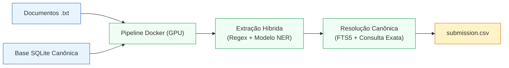

# Verificador de Citações Jurídicas — Desafio Jusbrasil x BRACIS 2026

Solução em contêiner Docker para identificação, resolução e classificação automática de citações jurídicas (acórdãos, súmulas e dispositivos legais) em peças processuais, determinando se cada referência é **real**, **inventada** ou **incompleta**.

---

## 📋 Pré-requisitos

- [Docker](https://www.docker.com/).
- GPU NVIDIA configurado  para uso com  Docker ([NVIDIA Container Toolkit](https://docs.nvidia.com/datacenter/cloud-native/container-toolkit/latest/install-guide.html)).

---

## ⚙️ Configuração do `.env`

Crie ou edite o arquivo `.env` na raiz do projeto indicando a estrutura de dados do desafio e a ativação da GPU:

```dotenv
INPUT_TXT_DIR=./data/desafio-jusbrasil-bracis-2026/txt
DATABASE_PATH=./data/desafio-jusbrasil-bracis-2026/desafio1_bracis.db
OUTPUT_DIR=./output

COMPOSE_PATH_SEPARATOR=;
COMPOSE_FILE=compose.yaml;compose.gpu.yaml
```

### Significado das variáveis:
- **`INPUT_TXT_DIR`**: Diretório contendo os arquivos `.txt` dos documentos a serem processados.
- **`DATABASE_PATH`**: Caminho do banco de dados SQLite canônico (`.db`).
- **`OUTPUT_DIR`**: Diretório onde o arquivo final de submissão será gravado.
- **`COMPOSE_PATH_SEPARATOR`** e **`COMPOSE_FILE`**: Habilitam a aceleração por GPU NVIDIA no Docker Compose.

> **Nota:** Todos os caminhos relativos partem da raiz do repositório. Para executar sobre um novo conjunto de documentos, basta atualizar `INPUT_TXT_DIR` e `DATABASE_PATH` com os caminhos da nova base.

---

## 🚀 Como Executar

Com o serviço do Docker ativo, execute o comando na raiz do repositório:

```bash
docker compose up --build --exit-code-from predict
```

O comando irá:
1. Construir a imagem Docker do pipeline com todas as dependências e o checkpoint local do modelo NER.
2. Executar a inferência acelerada por GPU sobre os documentos informados.
3. Encerrar automaticamente o contêiner ao concluir o processamento.

---

## 📄 Arquivo de Saída

O resultado final é gravado diretamente no diretório de saída especificado:

```text
./output/submission.csv
```


---

## 🧠 Arquitetura do Pipeline


