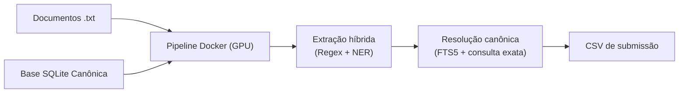

# Verificador de Citações Jurídicas — Desafio Jusbrasil x BRACIS 2026

Solução para resolver e classificar citações jurídicas em documentos judiciais como **reais**, **inventadas** ou **incompletas**.

## Modelo utilizado e licença

A extração de entidades usa o **Legal-BERT NER em português jurídico**, de **Maicon Domingues**, disponível no Hugging Face: [dominguesm/legal-bert-ner-base-cased-ptbr](https://huggingface.co/dominguesm/legal-bert-ner-base-cased-ptbr).

O modelo é disponibilizado sob a licença **Creative Commons Atribuição 4.0 Internacional (CC BY 4.0)**. O texto da licença está disponível em [CC BY 4.0](https://creativecommons.org/licenses/by/4.0/).

O projeto utiliza a [revisão `44210927c925448df025985e0ed48081bb5ac57c`](https://huggingface.co/dominguesm/legal-bert-ner-base-cased-ptbr/tree/44210927c925448df025985e0ed48081bb5ac57c). A procedência e os hashes dos arquivos estão registrados em [models/ner_legal_large/provenance.json](models/ner_legal_large/provenance.json), e a atribuição também consta em [THIRD_PARTY_NOTICES.md](THIRD_PARTY_NOTICES.md).

## Pré-requisitos

- Docker Desktop ou Docker Engine configurado para contêineres Linux.
- GPU NVIDIA e drivers configurados para acesso pelo Docker. No Linux, instale o [NVIDIA Container Toolkit](https://docs.nvidia.com/datacenter/container-toolkit/latest/install-guide.html); no Windows, use o Docker Desktop com suporte NVIDIA via WSL 2.

- Bash no Linux/WSL ou PowerShell no Windows.

## Executar

Passe o caminho do banco SQLite, a pasta com os `.txt` e o caminho completo para o CSV. O caminho de saída pode ser escolhido livremente; caminhos relativos partem do diretório atual.

```bash
bash run.sh ./data/desafio-jusbrasil-bracis-2026/desafio1_bracis.db ./data/desafio-jusbrasil-bracis-2026/txt ./output/submission.csv
```

No Windows PowerShell:

```powershell
.\run.ps1 .\data\desafio-jusbrasil-bracis-2026\desafio1_bracis.db .\data\desafio-jusbrasil-bracis-2026\txt .\output\submission.csv
```

O script constrói a imagem a partir do Dockerfile, valida CUDA dentro do contêiner e executa o pipeline com GPU NVIDIA. Na primeira execução, o build pode demorar enquanto baixa as dependências e os pesos. Execuções seguintes reaproveitam o cache do Docker.

O CSV é salvo exatamente no terceiro caminho informado. O contêiner é removido ao terminar; banco e documentos são montados somente para leitura.


## Arquitetura do Pipeline



O código foi feito com ajuda de IA.