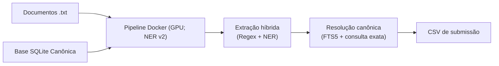

# Verificador de Citações Jurídicas — Desafio Jusbrasil x BRACIS 2026

Pipeline Docker para extrair e resolver citações em documentos judiciais, classificando-as como **reais**, **inventadas** ou **incompletas**. O padrão usa o checkpoint v2 selecionado da campanha de fine-tuning e a base SQLite canônica.

## Requisitos e preparação

- Docker Desktop em contêineres Linux e GPU NVIDIA disponível ao Docker. No Linux, instale o [NVIDIA Container Toolkit](https://docs.nvidia.com/datacenter/container-toolkit/latest/install-guide.html); no Windows, use suporte NVIDIA via WSL 2.
- Bash no Linux/WSL ou PowerShell no Windows; Git LFS instalado para baixar os checkpoints versionados.
- Os arquivos oficiais do desafio devem estar em `data/desafio-jusbrasil-bracis-2026/`: `txt/`, `desafio1_bracis.db` e, para pontuação, `goldenset_offsets.csv`.

Clone e prepare o repositório:

```bash
git clone --branch feat/solution-ner https://github.com/LucasSteffen5/taia-juris-check.git
cd taia-juris-check
git lfs install
git lfs pull
```

## Gerar a submissão oficial

Os comandos abaixo processam os 26 documentos oficiais do diretório `txt`, consultam o SQLite somente para leitura e gravam o CSV no terceiro caminho indicado.

Linux/WSL:

```bash
bash run.sh ./data/desafio-jusbrasil-bracis-2026/desafio1_bracis.db ./data/desafio-jusbrasil-bracis-2026/txt ./output/submission.csv
```

Windows PowerShell:

```powershell
.\run.ps1 .\data\desafio-jusbrasil-bracis-2026\desafio1_bracis.db .\data\desafio-jusbrasil-bracis-2026\txt .\output\submission.csv
```

O primeiro build inclui o checkpoint e instala as dependências. Ele verifica offline os hashes, o tokenizer, os 13 rótulos e a inferência do v2 (`52b24416c23a645db9aa49e83cf59e14aa8b225ae396f01d48415d50ae67945c`). O pipeline verifica a disponibilidade da GPU antes de prever.

O diretório de saída contém `submission.csv` e `run_manifest.json`, além dos detalhes auditáveis: cópias UTF-8 normalizadas em LF em `text_lf/`, JSONs com offsets LF em `json/` e JSONs remapeados aos offsets do texto original em `json_original/`. O CSV segue offsets Unicode da representação LF, compatível com o gabarito. A pasta de documentos oficiais e o SQLite são montados somente para leitura.

## Modelo e avaliação

O v2 foi selecionado pela validação local: score 0,675424; no teste local marcou 0,669523. Após congelar a seleção, o score nos 16 documentos oficiais reservados foi 1,082643; o v1 registrou 1,082703, diferença de 0,000060 atribuída ao bônus de calibração. A amostra reservada é referencial, não é o conjunto final cego e não determina a seleção do v2. A campanha e suas métricas estão detalhadas em [fine-tuning/README.md](fine-tuning/README.md).

As predições nos 26 documentos constituem uma submissão completa. Dez desses documentos foram autorizados para treinamento; não use o score agregado dos 26 como avaliação independente do modelo. A comparação final da campanha usa somente os outros 16, conforme os comandos `evaluate-official` documentados no guia do fine-tuning. Nenhum treinamento adicional é iniciado ao gerar uma submissão.

O NER identifica spans de jurisprudência, legislação e entidades auxiliares. A classificação final depende da resolução canônica e das regras do pipeline; os pesos não produzem sozinhos as classes finais do desafio.

O checkpoint deriva do Legal-BERT NER em português jurídico de Maicon Domingues ([modelo e revisão de origem](https://huggingface.co/dominguesm/legal-bert-ner-base-cased-ptbr/tree/44210927c925448df025985e0ed48081bb5ac57c)) e mantém a licença CC BY 4.0 e a atribuição correspondente em [THIRD_PARTY_NOTICES.md](THIRD_PARTY_NOTICES.md). Para publicar o artefato v2, consulte [fine-tuning/PUBLICAR_HUGGING_FACE.md](fine-tuning/PUBLICAR_HUGGING_FACE.md).

## Arquitetura


